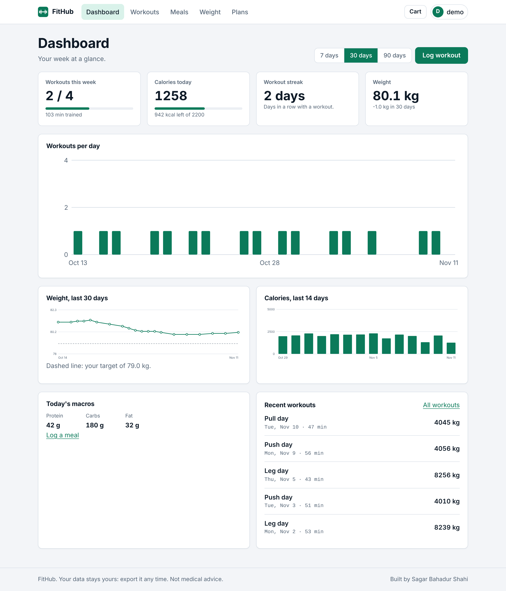
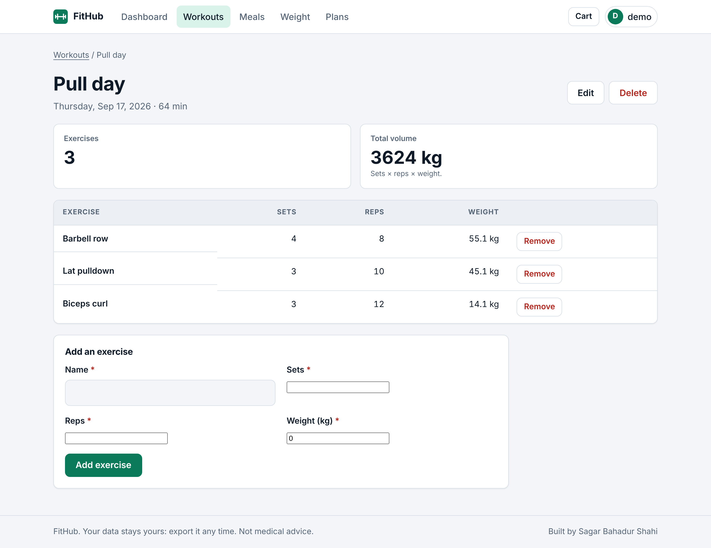
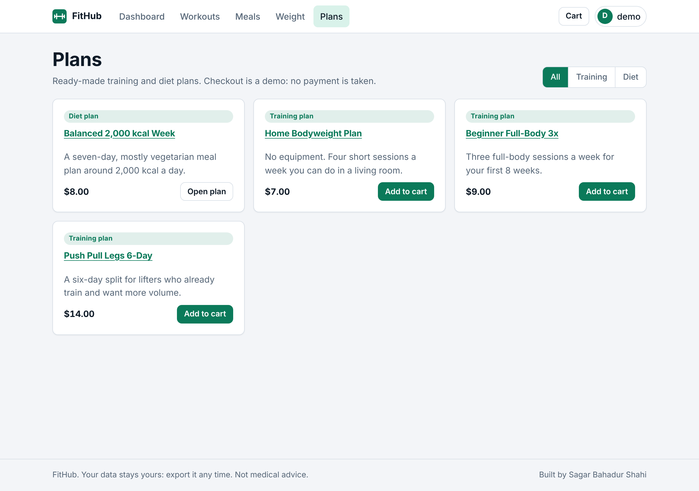
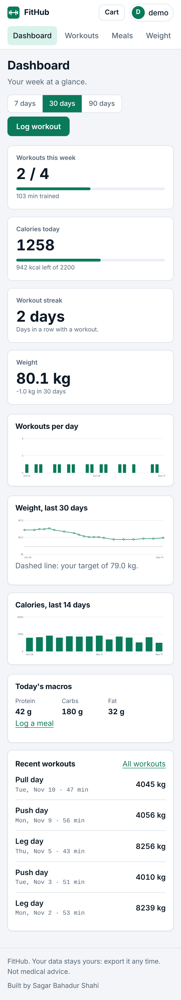
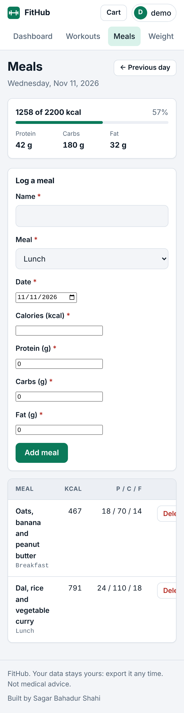

# FitHub

A private fitness tracker with a plan shop, built from scratch with Django 5.2 and Django REST Framework.
Log workouts, meals and body weight, see your weekly progress on a dashboard, and pick up training and diet plans.
Security and privacy are design constraints here, not an afterthought.



| Workout detail | Plans |
|---|---|
|  |  |

| Dashboard (phone) | Meals (phone) |
|---|---|
|  |  |

## Features
- **Workouts**: sessions with exercises (sets, reps, weight), automatic volume, edit and delete, CSV export.
- **Meals**: calories and protein/carbs/fat per meal, daily totals against your calorie target, day-by-day browsing.
- **Weight**: one entry per day, chart with your target line.
- **Dashboard**: weekly workout goal, calories left today, workout streak, 7/30/90-day charts. Charts are drawn as SVG on the server, so there is no chart library and no inline script.
- **Plan shop**: training and diet plans, cart, orders, and a "My plans" page. The full plan text is only sent to people who bought it.
- **REST API** with revocable API keys: workouts (with nested exercises), meals, weight and a summary.
- Light and dark theme, responsive layout, system fonts only.

> **Checkout is a demo.** No payment provider is connected, so no money is ever taken. The cart, orders and access rules are real inside the app, and prices are always read from the database, never from the browser. Adding a real provider (for example Stripe) is the natural next step.
> FitHub gives general fitness information, not medical advice.

## Quick start
```bash
python -m venv .venv && source .venv/bin/activate
pip install -r requirements.txt
cp .env.example .env            # sets DJANGO_DEBUG=True for local development only
python manage.py migrate
python manage.py seed_demo      # optional: demo user + 8 weeks of data + sample plans (DEBUG only)
python manage.py runserver
```
Then open http://127.0.0.1:8000/ and sign up, or log in with the demo account printed by `seed_demo`.
To create the sample plans on a live site run `python manage.py seed_plans`; you can also manage plans in the admin.

Run the tests with `python manage.py test` (158 tests, no setup needed).

## API
Create a key on the **API keys** page (shown once, stored only as a SHA-256 hash) and send it as a Bearer token.
Responses are JSON only; lists are paginated (`page`, `page_size` up to 100).

| Method | Path | Purpose |
|---|---|---|
| GET / POST | `/api/v1/workouts/` | List / create workouts, optionally with `exercises` |
| GET / PUT / PATCH / DELETE | `/api/v1/workouts/{id}/` | Sending `exercises` replaces them; leaving it out keeps them |
| GET / POST | `/api/v1/meals/` (`?date=YYYY-MM-DD`) | Meals |
| GET / POST | `/api/v1/weight/` | Weight; posting an existing day replaces its value |
| GET | `/api/v1/summary/` | This week, today and latest weight in one call |

```bash
curl -H "Authorization: Bearer fh_..." -H "Content-Type: application/json" \
  -d '{"date":"2026-11-12","name":"Push day","duration_min":55,"exercises":[{"name":"Bench press","sets":4,"reps":8,"weight_kg":"60"}]}' \
  http://127.0.0.1:8000/api/v1/workouts/
```
Fields the server owns (`owner`, `id`, `volume_kg`, timestamps) are ignored if sent. Other users' records return `404`.
Limits: 120 requests/min per user, 20/min anonymous, repeated bad keys are blocked.

## Security
Both of your checklists were applied. "N/A" means the feature does not exist here, so there is nothing to protect.

| Item | Status | Where |
|---|---|---|
| Hide API keys / check env variables | Done | Configuration comes from environment variables; `.env` is git-ignored; production refuses to start without `DJANGO_SECRET_KEY` and `DJANGO_ALLOWED_HOSTS`. API keys are shown once and stored hashed. |
| Purge / scan Git for secrets | Done | A test scans every tracked file for secret patterns and checks `.env` is not tracked. This repository's history starts clean. |
| Public DB key, RLS | N/A | No browser-side database access. The database is only reachable from the server. |
| Encrypt sensitive data / secure database | Partly | Passwords and API keys are hashed. No payment or card data exists (demo checkout). Disk or database encryption is the host's job; use TLS to a managed database via `DATABASE_URL`. Health-type data (weight, meals) is stored in plain form, like any normal app database. |
| Server-side auth, proper authentication | Done | Django sessions for the web app, Bearer API keys for the API; every app page and API route requires login (tested route by route). |
| Lock record access, access control | Done | Every query is scoped to the owner; another user's workout, meal, weight, cart or order returns 404. Plan content is gated by purchase. Tested for each page and API route. |
| Block field tampering | Done | Explicit form and serializer field lists; the owner, ids, totals, prices and timestamps cannot be set by a client. The checkout total is recomputed on the server from database prices (tested with a forged price). |
| Secure session cookies | Done | `Secure`, `HttpOnly`, `SameSite` in production (verified under gunicorn). |
| Hash passwords | Done | Argon2, with Django's password validators (minimum 10 characters, common and numeric passwords rejected). |
| Rate limit login, bot protection | Done | Login lockout per IP+username, admin lockout, registration limits plus a honeypot field, checkout limit, API throttles. |
| Parameterize queries | Done | Django ORM only; no raw SQL. |
| Validate / sanitize all input | Done | Range checks on every number, date-not-in-future, length limits, per-user quotas (workouts, exercises, meals per day). Bad values give clear errors and never a server error. |
| Escape user content, XSS | Done | Template auto-escaping, no `|safe`, strict CSP with no inline scripts or styles (a test enforces this), CSV formula-injection guard. |
| Restrict file uploads | N/A | There are no uploads. |
| Trim API responses | Done | Serializers list their fields one by one. |
| Secure API endpoints, CORS | Done | JSON only, auth and throttles everywhere, CSRF on session auth. CORS is not enabled, so other websites cannot call the API from a browser. |
| Security headers | Done | CSP, HSTS, X-Frame-Options DENY, nosniff, Referrer-Policy, Permissions-Policy, no-store. |
| Force HTTPS | Done | SSL redirect and HSTS in production (verified with gunicorn behind a simulated proxy). |
| Protect admin routes | Done | Admin moved off `/admin/` (set `ADMIN_URL`), login lockout, order records are read-only in the admin. |
| Debug mode off | Done | Off unless `DJANGO_DEBUG=True`. |
| Update dependencies, scan, remove unused | Done | `pip-audit` reports no known vulnerabilities and `bandit` is clean (CI runs both). Only needed packages are listed. |
| Check exposed files | Done | Only collected static files are served. |
| Full security audit | Done by me, not by a third party | Automated scans and tests above. Not an independent penetration test. |

See [SECURITY.md](SECURITY.md) to report a problem.

## Deploying
1. Set environment variables (see `.env.example`): `DJANGO_SECRET_KEY` (long random value), `DJANGO_ALLOWED_HOSTS`, `DJANGO_CSRF_TRUSTED_ORIGINS=https://your.domain`, and `DJANGO_TRUSTED_PROXY_COUNT=1` when behind one reverse proxy. Optionally `DATABASE_URL` (Postgres recommended), `ADMIN_URL`, `DJANGO_TIME_ZONE`.
2. Raise `DJANGO_HSTS_SECONDS` (for example `31536000`) once HTTPS works everywhere.
3. `python manage.py migrate && python manage.py collectstatic --noinput`, then `gunicorn fithub.wsgi`.
4. Check with `python manage.py check --deploy`.

A `Dockerfile` (non-root user) is included. I could not pull the `python:3.13-slim` base image where this was written (registry access was blocked), so the image itself is unbuilt. I did run its exact steps by hand as an unprivileged user on Python 3.13 (install requirements, `collectstatic`, `migrate`, 3 gunicorn workers) and the app served pages, static files and `/healthz/` correctly. Run `docker build -t fithub .` once to confirm. Rate limits use Django's cache; with several server processes use a shared cache such as Redis for exact limits.

## Layout
`core/` security headers, throttling, admin lockout, error pages · `accounts/` registration, login, API keys · `tracker/` workouts, meals, weight, goals, analytics, API · `shop/` plans, cart, orders · `templates/`, `static/` frontend.

Built by Sagar Bahadur Shahi.
